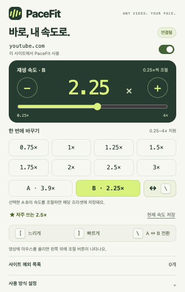
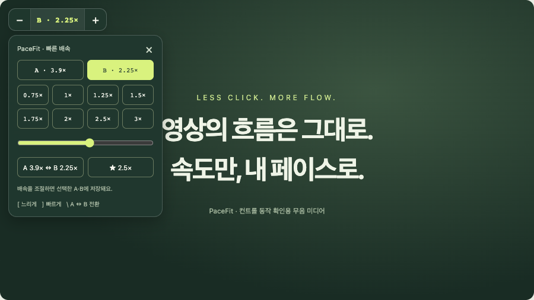

# PaceFit · 페이스핏 v0.3.5

**바로, 내 속도로.** 웹사이트의 HTML5 영상·오디오 배속을 영상 위 버튼·단축키·빠른 프리셋으로 조절하는 Chrome 확장프로그램입니다. YouTube, 일반 영상 사이트, 다른 도메인의 임베드 영상에서 사용할 수 있으며 사이트별 예외를 설정할 수 있습니다.

v0.2는 수동 배속에 집중합니다. 자막 분석·자동 배속 기능을 제거했으며, 자막 유무나 언어와 관계없이 사용할 수 있습니다. 서버·API 키·빌드 과정이 필요하지 않습니다.

## 설치 / 업데이트

1. Chrome 주소창에서 `chrome://extensions`를 엽니다.
2. **개발자 모드 → 압축해제된 확장 프로그램을 로드합니다**를 선택합니다.
3. 프로젝트의 **`extension` 폴더**를 선택합니다.
4. 사용할 영상 사이트의 탭을 새로고침합니다.

설치할 폴더:

```text
/Users/al03230166/projects/moon-lab/pacefit/extension
```

기존 설치자는 같은 경로를 유지하고 `chrome://extensions`에서 **PaceFit 새로고침**을 누른 뒤 **영상 사이트 탭도 새로고침**하면 됩니다. **v0.3부터 모든 HTTP/HTTPS 사이트 접근이 필요하므로 Chrome이 새 권한 검토나 확장 다시 켜기를 요구할 수 있습니다.** Chrome의 사이트 액세스를 제한한 경우 허용한 사이트에서만 작동합니다. 기존 수동 배속 값은 이어서 사용합니다.

다른 컴퓨터에서는 **`pacefit-0.3.5.zip`**을 해제한 폴더를 로드하세요. ZIP 안의 최상위에 `manifest.json`이 있습니다. Chrome 웹 스토어에는 아직 등록하지 않았습니다.

## 사이트 예외 설정

- 팝업 상단의 **이 사이트에서 PaceFit 사용**을 끄면 현재 사이트를 예외에 추가합니다. 다시 켜면 해제합니다.
- **사이트 예외 목록**에서 도메인이나 URL을 입력해 추가하고, 각 항목의 **해제** 버튼으로 삭제할 수 있습니다.
- `example.com`은 `news.example.com` 등 모든 하위 도메인에도 적용됩니다. `www.example.com`과 `*.example.com`은 `example.com`으로 정리합니다. 경로·프로토콜·포트별 구분은 하지 않습니다.
- 예외 사이트에서는 버튼·단축키·다음 영상 배속 유지가 꺼집니다. PaceFit이 적용한 속도만 원래 값으로 복구하고, 사이트나 사용자가 직접 바꾼 값은 보존합니다.
- 다른 사이트에서 불러온 임베드는 **상위 페이지 도메인과 임베드 도메인 모두** 예외 검사를 합니다. 예를 들어 `embed.example`을 제외하면 다른 사이트의 해당 임베드도 꺼집니다.
- 상위 도메인 예외에 포함된 하위 사이트는 예외 목록에서 그 상위 도메인을 해제해야 켤 수 있습니다. 현재 사이트 스위치로 다른 하위 사이트의 예외까지 자동 삭제하지 않습니다.
- 변경은 이미 열려 있는 탭과 임베드에도 적용되며, 예외 목록은 브라우저 로컬에 저장됩니다.

## 팝업을 열지 않고 조절하기

**영상 플레이어에 마우스를 올리면** 왼쪽 위에 **`−  1.5×  +`** 형태의 작은 컨트롤이 표시됩니다. 마우스가 플레이어 밖으로 나가면 버튼과 열린 메뉴가 사라집니다. 키보드로 컨트롤을 탐색 중일 때는 포커스를 잃지 않도록 표시를 유지합니다.

- `− / +`: 즉시 느리게 / 빠르게 조절합니다.
- **배속 숫자 클릭**: 8개 프리셋과 슬라이더가 있는 메뉴를 엽니다.
- **A ↔ B 프리셋 전환**: A·B에 저장한 두 속도를 번갈아 적용합니다. A에서 1.5배속, B에서 2.3배속으로 맞추면 이후 1.5 ↔ 2.3배속으로 왕복합니다.
- **선택한 프리셋 조정**: 팝업이나 영상 위 메뉴에서 A·B를 선택하고 배속을 조절하세요. 버튼·슬라이더·직접 입력·빠른 배속 버튼·단축키로 조정한 값은 선택한 프리셋에 자동 저장됩니다. 다른 프리셋의 값은 유지됩니다.
- 영상 위 현재 배속과 영상 시작·속도 변경 알림에는 **A · 1.5×**, **B · 2.3×**처럼 선택한 프리셋을 함께 표시합니다. 팝업의 재생 속도 제목에도 A·B를 표시합니다.
- **★ 자주 쓰는 속도**: 저장한 배속을 한 번에 적용합니다.
- 바깥을 클릭하거나 메뉴 안에서 `Esc`를 누르면 메뉴가 닫힙니다. `Esc`로 닫으면 배속 메뉴 버튼에 포커스가 돌아갑니다.

컨트롤은 스크롤·창 크기 변경에 맞춰 영상 위치를 따라가고, 컨테이너 전체화면에서도 사용할 수 있습니다. 오디오 요소에서는 요소 위쪽에 표시합니다. YouTube 광고 감지 중에는 숨겨집니다. 필요 없다면 팝업의 설정에서 표시를 끌 수 있습니다.

## 키보드 단축키

영상이나 오디오가 있는 웹사이트 탭에서:

| 키 | 동작 |
|---|---|
| `[` | 한 단계 느리게 |
| `]` | 한 단계 빠르게 |
| `\` | A ↔ B 프리셋 전환 |

한국어 키보드에서는 `\` 위치가 `₩`로 표시될 수도 있습니다. 입력 언어와 관계없이 같은 물리 키로 동작합니다.

- 기본 조절 간격은 **0.1배**이며, 0.05 / 0.1 / 0.25배로 변경할 수 있습니다.
- `[`와 `]`는 길게 눌러 연속 조절할 수 있습니다. `\`는 길게 눌러도 한 번만 전환합니다.
- 단축키로 배속을 바꾸면 같은 위치에 현재 배속을 **1.5초** 표시한 뒤 사라집니다. 연속 조절하면 마지막 입력부터 1.5초를 다시 셉니다. 버튼 표시를 꺼도 배속 알림은 표시됩니다. 마우스를 올려 이미 버튼이 보이는 동안에는 별도 알림을 겹치지 않습니다.
- 영상을 처음 열거나 다음 영상으로 이동해도 같은 알림으로 현재 배속을 **1.5초** 표시합니다. 같은 영상을 일시정지했다가 재생할 때는 반복 표시하지 않습니다.
- 검색창·댓글·텍스트 편집기·슬라이더 등에서 입력 중이거나 IME 조합 중에는 가로채지 않습니다.
- Ctrl / Alt / Option / Command / Shift 조합을 가로채지 않습니다.
- YouTube 광고 감지 중에는 단축키를 적용하지 않습니다. 다른 사이트의 광고를 일반적으로 판별하는 기능은 없습니다.
- 단축키 전체를 설정에서 끌 수 있습니다. 브라우저 바깥의 전역 단축키는 등록하지 않습니다.
- 부모 페이지에 영상이 없고 임베드 영상만 있는 경우에도 단축키를 전달합니다. 영상이 여러 개면 재생 중인 영상, 최근 조작한 영상, 크기와 화면 표시 여부를 바탕으로 대상을 고릅니다. 영상에 마우스를 올리거나 해당 영상의 컨트롤을 사용하면 그 대상을 선택합니다.

## 팝업에서 조절하기

확장 아이콘을 누르면 배속 숫자·슬라이더·프리셋·자주 쓰는 속도를 한 화면에서 사용할 수 있습니다.

- **지원 범위: 0.25~4배**, 직접 입력과 슬라이더의 미세 조절 간격은 0.05배입니다.
- 프리셋: 0.75 / 1 / 1.25 / 1.5 / 1.75 / 2 / 2.5 / 3배.
- **현재 속도 저장**: 현재 배속을 자주 쓰는 속도로 저장합니다. 기본값은 1.5배입니다.
- **다음 영상에도 배속 유지**: 켜면 PaceFit에서 마지막으로 선택한 배속을 다음 영상에 적용합니다. 끄면 새 영상은 1배속으로 시작하며 저장한 배속은 지우지 않습니다.
- **A ↔ B 프리셋 전환** 버튼과 `\` 단축키는 선택된 A·B를 전환합니다. A에서 여러 번 속도를 조절해도 B는 그대로 기억합니다. 두 프리셋을 같은 속도로 맞춰도 A·B 선택은 구분하며, 이후 조절하면 선택한 쪽만 갱신합니다.
- A·B의 속도와 마지막 선택을 함께 저장합니다. 다음 영상에도 배속 유지를 켜면 마지막 속도로 시작하며 A·B를 이어서 사용할 수 있습니다. 최초 설치 시 A는 1배속, B는 2배속이고, 기존 설치에서 업데이트하면 A는 기존에 저장한 배속으로 시작합니다.
- 사이트 기본 배속 메뉴에서 바꾼 속도는 현재 영상에 반영하며 다음 영상의 저장 배속은 바꾸지 않습니다.
- 영상 전환·미디어 로딩 때 저장한 배속을 적용하고, 초기 6초 안에 플레이어가 1배속으로 되돌리면 제한된 횟수로 복구합니다. 플레이어 내부 초기화를 사용자 선택으로 저장하지 않습니다.
- 한 탭에서 속도를 바꿔도 **다른 탭의 재생 중인 영상은 건드리지 않습니다.** 마지막 배속과 환경설정은 브라우저 로컬에 저장하며, 다음 영상에서 사용합니다.
- YouTube 광고 중 팝업에서 선택한 속도는 본 영상으로 돌아올 때 적용합니다.





## 지원 범위

데스크톱 Chrome 119+의 HTTP/HTTPS 웹사이트에 있는 표준 `<video>`·`<audio>` 요소를 대상으로 합니다. 동적으로 추가되는 미디어, 다른 도메인의 iframe, 접근 가능한 열린 Shadow DOM 내부 미디어도 탐색합니다.

모든 사이트의 동작을 보장하지는 않습니다. Chrome 내부 페이지·Chrome 웹 스토어·로컬 파일은 적용 대상이 아닙니다. 닫힌 Shadow DOM, 브라우저가 접근을 막은 프레임, 표준 미디어 요소를 사용하지 않는 플레이어, 사이트가 속도를 강제로 되돌리는 경우에는 제한될 수 있습니다. 실시간 방송과 보호된 플레이어는 서비스의 재생 제약을 따릅니다.

Picture-in-Picture 창과 `<video>` 자체를 브라우저 네이티브 전체화면으로 연 경우에는 HTML 조절 버튼을 겹쳐 표시할 수 없습니다. HTML 컨테이너 전체화면은 지원합니다. 광고 감지와 복귀 처리는 현재 YouTube에 한해 제공하며, 다른 사이트의 광고 미디어는 일반 영상처럼 인식될 수 있습니다. 다른 배속 확장과의 동시 제어는 피하는 것이 좋습니다.

## 개인정보 / 권한

- `storage`: 현재 배속·A/B 프리셋과 선택 상태·자주 쓰는 속도·조절 간격·컨트롤/단축키/배속 유지 여부·사이트 예외 목록을 Chrome 로컬 저장소에 저장합니다.
- `activeTab`: 팝업을 연 현재 탭의 문맥에 접근합니다.
- 모든 HTTP/HTTPS 사이트 접근: 각 페이지와 임베드의 미디어 요소를 찾아 배속을 조절합니다. Chrome에 **모든 웹사이트의 데이터 읽기 및 변경** 권한이 표시될 수 있습니다.
- 영상·오디오 파일 내용이나 마이크를 수집·녹음하지 않습니다. 미디어 요소의 재생 상태·배속·위치를 사용하며, 외부 서버 통신·추적·외부 폰트·페이지 네트워크 요청 가로채기가 없습니다. 방문 기록을 저장하지 않습니다.
- 확장 삭제 시 저장된 설정도 삭제됩니다.

## 미리보기 / 개발

`extension/popup.html`을 브라우저에서 열면 **데모 모드**로 UI와 사이트 예외를 조작할 수 있습니다. 실제 영상이나 Chrome 설정에 영향을 주지 않습니다. 영상 위 컨트롤은 확장을 설치한 영상 사이트 탭에서 사용합니다.

```sh
npm run preview
```

미리보기: `http://127.0.0.1:4173/extension/popup.html`

프로덕션 의존성이 없으며 Node.js 20+에서:

```sh
npm test
npm run check
npm run package
```

- `npm test`: 설정 마이그레이션·배속 계산·A/B 프리셋별 조절과 왕복·입력 중 단축키 제외 테스트.
- `npm run check`: Manifest, 자산 경로, PNG 헤더, JavaScript 문법, 최소 권한 검사.
- `npm run package`: 배포용 확장 ZIP 생성.
- `scripts/browser-check.cjs`: 팝업 조작·연속 클릭·설정·레이아웃 검사.
- `scripts/retention-check.cjs`: 지연된 1배속 초기화, 미디어 로딩 이벤트, A/B 프리셋별 조절과 저장·왕복, 명시적 1배속 저장, 기본 플레이어 배속 선택, 유지 설정 끄기/켜기, 페이지 이동과 미디어 교체를 검사.
- `scripts/extension-check.cjs`: 임시 Chrome에 실제 확장을 설치해 영상 위 컨트롤·네이티브 미디어·단축키·입력 제외·광고·영상 전환·탭 분리·전체화면·저장소를 검사.
- `scripts/cross-site-check.cjs`: 일반 HTML5 영상, HTTP 오디오, 다른 도메인의 임베드, 부모 페이지 단축키 전달, 다중 미디어 선택, 동적 열린 Shadow DOM, 사이트 예외·하위 도메인·원래 배속 복구를 검사.

선택적 브라우저 검사에는 Playwright와 Chrome/Chromium이 필요합니다. 시스템 Chrome을 쓸 경우 `PACEFIT_CHROME`에 실행 파일 경로를 지정하고, Playwright를 Node 모듈 경로에 설치하세요. 확장 설치 검사에는 `Extensions.loadUnpacked`를 지원하는 최근 Chrome이 필요합니다. 테스트는 임시 프로필을 쓰며 사용자 프로필을 수정하지 않습니다.

자세한 결과는 [검증 기록](docs/verification.md)에 있습니다.

```text
extension/
  manifest.json       Manifest V3, 모든 HTTP/HTTPS 페이지와 프레임
  background.js       팝업과 미디어 프레임 사이의 명령 전달
  core.js             배속·설정·단축키 판단 로직
  content.js          미디어 탐색·제어·사이트 예외·단축키
  overlay.js          영상 위치를 따라가는 Shadow DOM 컨트롤
  popup.html/css/js   확장 팝업 및 명시적 데모
  icons/              로컬 PNG 아이콘
tests/                단위 테스트 및 실제 미디어 테스트 페이지
scripts/              검사 및 패키지 생성
docs/                 화면과 검증 기록
```
